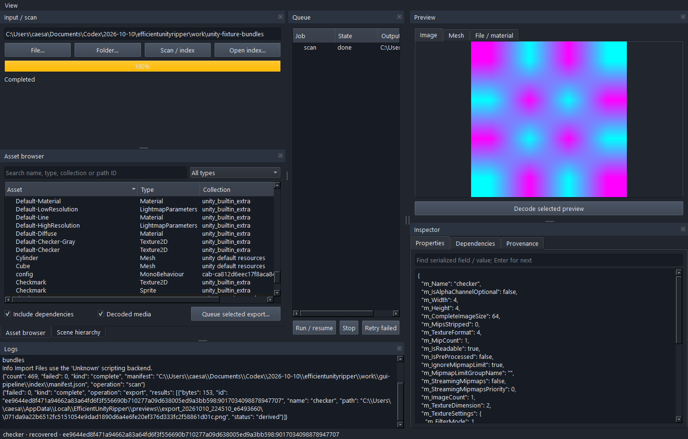
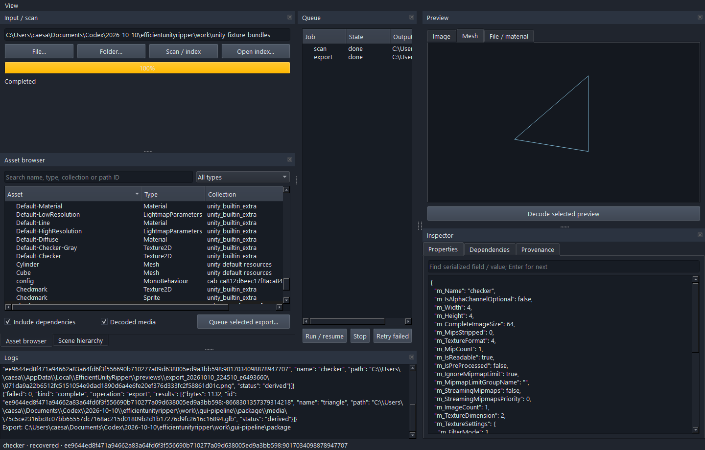

# Actual validation, 2026-10-10

Test machine: Windows 10 build 19045 x64, Python 3.14.2, PySide6 6.12.0, local .NET SDK 10.0.401. Headroom `init-user` health was verified ready/healthy (0.37.0), including before final validation. Upstreams were read at the exact commits in SOURCE_AUDIT.md. No upstream source modifications were made.

## Build and authored fixtures

`dotnet publish backend -c Release -p:AssetRipperRoot=<audited checkout> -o .local/backend` succeeded. Initial clean upstream compilation emitted two existing TODO warnings (sprite edges, animator); final incremental publish succeeded without errors. This is a framework-dependent local backend, with .NET 10 supplied through the local environment.

Final `unittest discover -s tests -v`, with `EUR_BUNDLE_FIXTURE` set to our Unity-editor-authored bundle folder: **12 tests passed**, 7.222 seconds. Base tests cover content fingerprints, directory/read-only boundaries, queue recovery, traversal rejection, actual binary Unity import/fields/hierarchy, injected-resource classification, PNG decode, corrupt-cache rebuild/object checkpoint reuse, selected/collection package export/no overwrite, and backend errors followed by a successful ping. Broader fixture tests verify custom MonoBehaviour/ScriptableObject fields, physics/UI/terrain/scene/NavMesh settings, rig/controller/animation types and real GLB/PNG decoding. `compileall` and CLI help also passed.

The base fixture writer creates 8 authored input objects in a real Unity serialized binary: GameObjects/Transforms, light, collider, 2×2 RGBA texture and material. AssetRipper adds version-specific engine placeholders; these are not counted as authored recovery.

Unity 6000.3.7f1 batch mode actually built our second fixture from source scripts, with uncompressed scene/assets bundles. Engine indexing produced 469 records: 114 recovered input records and 355 injected engine records (354 derived, 1 partial). Custom fields included `moveSpeed=4.25`, `lives=7`, checkpoint `(3,4,5)`, config `jumpHeight=2.75`, authored rig/skin and animation/controller data, RectTransforms, mass 3.5, and terrain. This is fixture evidence, not proof of equivalent recovery for every commercial game.

Static triangle GLB and real binary FBX were exported. Independent Assimp reader (assimp_py 1.2.0) read both: 3 vertices, 1 triangle, nonempty files. PNG was decoded independently through QImage: expected 2×2 and 4×4 fixture dimensions. `docs/qa/fixture-media-validation.json` retains mesh validation counts.

## Actual GUI and background

Two GUI scripts launched the actual Qt window. Smoke checks exercised asset search, selection, material `_MainTex` inspection, dependencies and inspector field search. Pipeline smoke executed the real importer through the worker/queue, decoded a PNG into the preview, exported JSON and GLB, rendered a rotatable wireframe, and recorded done states/logs. Screenshots were opened and visually inspected; layout was corrected before final capture.

The hidden `background-index.ps1` launcher was executed on our binary fixture. Its process completed with real `complete` output, zero stderr, 306 indexed records for that fixture version, and a generated `agent-context.md`. CLI/background operation does not require the GUI to remain open. Windows paths remain usable only to agents with filesystem access; no ChatGPT file connector was installed.

## Final authorized Planet of Lana II sample

This was performed **after MVP implementation, authored-fixture tests and self-review**, using the user's explicit final-test authorization. Steam library/appmanifest identified **Planet of Lana II**, app 2997230, build 22899183, installed as Planet of Lana 2. Real serialized header/import evidence gives **Unity 6000.0.61f1**.

Five bounded files were copied read-only into a separate local test folder outside this source Git repository: one UI/scene sample plus one small mesh container and required sidecars. Input sample bytes total 22,420,932, compared with a Steam installation around 43 GB. No complete game extraction was performed. Five original-file SHA-256 checks matched before and after the test.

The UI/scene index has 7,305 records: **6,982 original input records** (4,101 recovered, 2,881 partial) and **323 engine-injected records**. The small mesh index has 355 records: **32 input records** (25 recovered, 7 partial) and 323 injected records. Missing external dependencies/type layouts in these deliberately isolated samples limit script/config data; partial records are not presented as recovered mechanics.

Two representative meshes exported to GLB and actual FBX using AssetRipper geometry decoding plus existing Blender 5.1 conversion. Independent Assimp read both FBX files: **1,506 and 72 triangles**, nonzero finite geometry, sizes **88,668 and 20,236 bytes**. Corresponding GLB triangle counts agree. Vertex counts differ because FBX reader expands triangle corners/attribute splits; no identical vertex-layout claim is made.

One real texture decoded to **4096×4096 PNG**, 11,349,010 bytes. QImage decoded it successfully and sampled pixels vary. This verifies pixel decoding/resolution/nonempty content, not GPU shader or scene appearance parity.

The tracked `docs/qa/game-sample-summary.json` contains counts/version/status only. Game-derived serialized data, images, FBX/GLB, copied samples and detailed per-asset results remain exclusively in the local sibling `outputs/PlanetOfLanaII-Test` folder. They are not source fixtures or GitHub contents. No original gameplay run, full game coverage, 1:1 scene reconstruction, animated FBX, script logic recovery, or shader equivalence was tested or claimed.

GitHub publication is verified separately after tracked-file review. The private visibility check must precede any source push and be repeated afterward; source-only upload excludes local environments and game samples.
